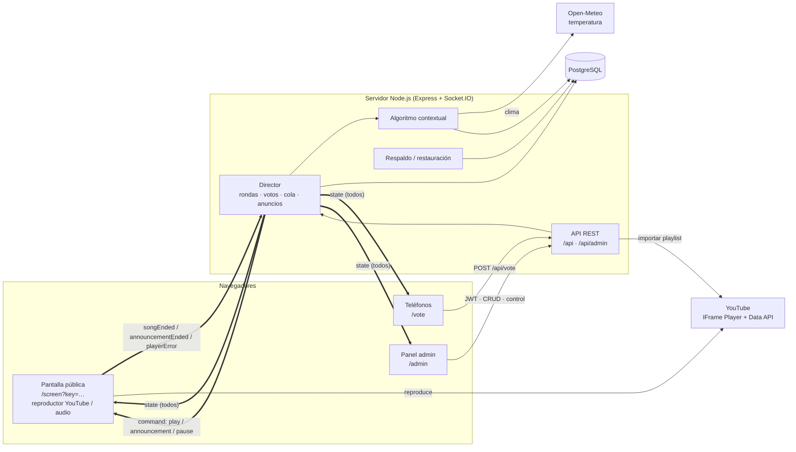
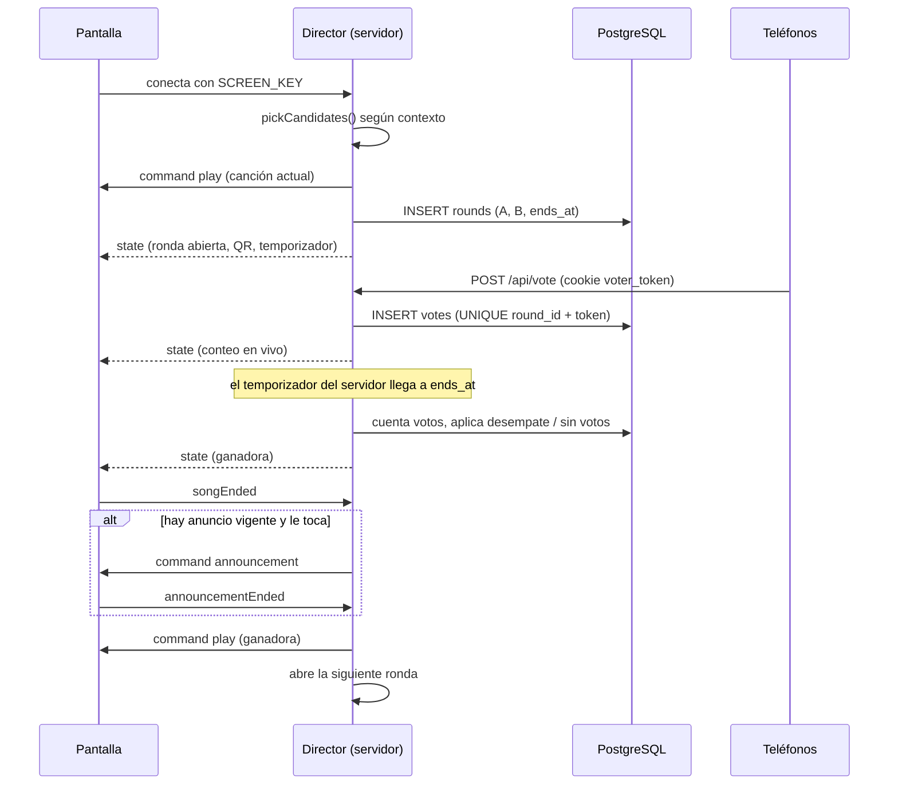

# Arquitectura

## Vista general

Un único servicio Node.js sirve la API REST, el canal en tiempo real (Socket.IO) y la aplicación React compilada. El estado de la programación (fase, ronda abierta, cola) vive en el **Director** del servidor, que es la única autoridad: abre y cierra las rondas con su propio reloj, cuenta los votos en la base de datos y ordena a la pantalla qué reproducir. Los navegadores solo muestran el estado que reciben.

La voz de los anuncios y del locutor se sintetiza en el navegador de la pantalla con la mejor voz española disponible; el servidor solo transmite el texto.

### Locutor automático (`server/src/dj.js`)

Cada *N* canciones, al terminar una canción y antes de la ganadora, el Director inserta una intervención del locutor (fase `announcement`, `kind: 'dj'`). El texto se prepara en cuanto cierra la ronda, para no dejar silencio: con `GEMINI_API_KEY` lo redacta Gemini a partir de datos reales (canción anterior, ganadora y votos, temperatura, próximo evento) con un límite de 6 s; sin clave o si falla, se arma con plantillas. La pantalla lo lee con la Web Speech API, lo muestra como rótulo inferior y avisa `announcementEnded`; si el navegador nunca avisa, un temporizador de respaldo continúa la programación.

## Flujo de una ronda

Si la canción termina antes que el temporizador, la ronda se cierra en ese momento. Si el temporizador termina antes, la ganadora espera a que acabe la canción actual. Así la votación ocurre siempre mientras suena la canción actual y los anuncios nunca se superponen con la música.

## Algoritmo de selección contextual (`server/src/context.js`)

1. **Contexto**: hora local (`STATION_TZ`), temperatura de Open-Meteo (caché de 10 min) y tipos de evento activos en la tabla `events`. El administrador puede simular cualquiera de los tres.
2. **Reglas que coinciden**: se evalúan las reglas activas (hora, rango de temperatura, tipo de evento) y se ordenan por prioridad.
3. **Combinación**: para cada filtro (géneros, energía, ambiente, temática) manda la regla de mayor prioridad que lo defina; las de menor prioridad completan los filtros libres. Ejemplo: «Mañana» fija energía media y «Calor» fija ambiente fresco → ambas se aplican. Una regla **exclusiva** (p. ej. exámenes) detiene la combinación.
4. **Exclusiones**: canciones inactivas, con restricciones excluidas en Ajustes (p. ej. `explicit`), la canción actual y las últimas *N* reproducidas. Si se selecciona una lista para rotación automática, solo sus canciones se ofrecen a votación.
5. **Relajación**: si quedan menos de dos canciones, se descartan las reglas de menor prioridad una por una.
6. **Respaldo**: si aun así no hay dos opciones, o si no hay datos de clima o calendario, se usa la lista de respaldo autorizada (también filtrada por restricciones).
7. Se eligen dos al azar. El nombre de las reglas aplicadas queda guardado en la ronda.

## Tiempo real y consistencia

- Socket.IO difunde el evento `state` a todos los clientes en cada cambio. Incluye `serverTime` para que cada dispositivo calcule el temporizador con el reloj del servidor, sin depender del reloj del teléfono.
- Las operaciones del Director se encolan (`director.run`) para que votos, cierres y comandos no se pisen.
- Al reiniciar, las rondas abiertas se marcan como `aborted` y la programación se reanuda cuando la pantalla vuelve a conectarse.
- Limitación: el estado vive en memoria de **una sola instancia**. No se debe escalar horizontalmente sin mover ese estado a un almacén compartido.

## Seguridad

- Panel: inicio de sesión con contraseña cifrada (bcrypt), JWT de 8 h, límite de 10 intentos cada 15 min.
- Pantalla: clave `SCREEN_KEY` para recibir comandos de reproducción.
- Votos: cookie `voter_token` (httpOnly, 30 días) con restricción única por ronda y límite de 20 votos/min por IP. Una persona que borre sus cookies podría votar de nuevo; se decidió no limitar por IP porque en la red del campus muchos teléfonos comparten IP pública.
- Secretos solo en variables de entorno.

## Manejo de fallas

| Falla | Comportamiento |
|---|---|
| Pantalla desconectada | Indicador en panel y pantalla; Socket.IO reconecta solo y la pantalla recibe el comando actual |
| Error del reproductor (video no disponible, audio inaccesible) | Se registra en «Último error» y se pasa a la siguiente canción |
| Clima o calendario no disponibles | Selección desde la lista de respaldo; aviso en el panel |
| Sin canciones elegibles | Reintento cada 30 s; mensaje en el panel |
| Navegador sin síntesis de voz | Se registra un error del reproductor y el programa continúa |
| Base de datos caída | `/api/health` responde 503 y el proveedor de alojamiento reinicia o alerta |
| Pérdida de configuración | Restaurar desde el respaldo JSON (Ajustes → Respaldo) |
