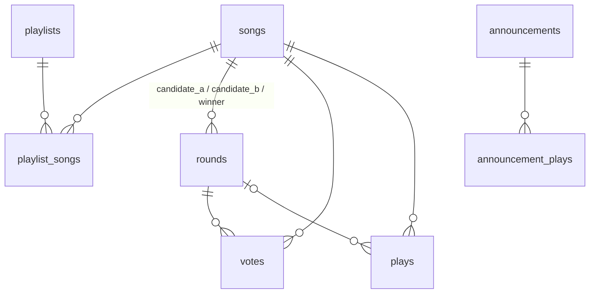

# Base de datos

PostgreSQL. El esquema está en [`server/src/schema.sql`](../server/src/schema.sql) y se aplica automáticamente cada vez que arranca el servidor (`CREATE TABLE IF NOT EXISTS`), así que basta con crear una base vacía y definir `DATABASE_URL`.

## Creación

```bash
# Local
createdb radio_campus
# o en psql / pgAdmin:
CREATE DATABASE radio_campus;
```

Para aplicar el esquema a mano (opcional): `psql "$DATABASE_URL" -f server/src/schema.sql`.

## Diagrama



## Tablas

| Tabla | Contenido |
|---|---|
| `admins` | Usuarios del panel (`email`, `password_hash` bcrypt) |
| `songs` | Catálogo: `title`, `artist`, `provider` (`youtube` / `licensed_audio`), `stream_ref` (ID de video o URL), etiquetas `genre`, `energy` (low/medium/high), `mood`, `themes[]`, `restrictions[]`, `active` |
| `playlists`, `playlist_songs` | Listas y su relación con canciones (una de ellas puede ser la de respaldo) |
| `events` | Festividades y eventos: `name`, `type` (`exam`, `holiday`, `event`), `starts_at`, `ends_at` |
| `context_rules` | Reglas: `priority`, `condition` JSON (`time_from`, `time_to`, `temp_min`, `temp_max`, `event_type`, `exclusive`), `filters` JSON (`genres`, `energy`, `moods`, `themes`), `active` |
| `announcements` | Texto, `status` (draft/approved), `audio` MP3 generado, vigencia (`valid_from/to`), horario (`hour_from/to`), frecuencia `every_n_songs`, `last_played_at` |
| `rounds` | Cada votación: candidatas, apertura, `ends_at`, cierre, `status` (open/closed/aborted), conteo, ganadora, `resolution`, regla aplicada |
| `votes` | Un voto por `voter_token` y ronda (restricción `UNIQUE`), con IP y hora |
| `plays` | Historial de reproducción con su origen (votación, admin, inicio) |
| `announcement_plays` | Historial de anuncios reproducidos |
| `settings` | Ajustes clave-valor JSON: `round_seconds`, `tie_break`, `no_votes`, `recent_window`, `excluded_restrictions`, `fallback_playlist_id`, `context_override` |

## Respaldos

- **Configuración** (catálogo, listas, reglas, eventos, anuncios con su audio y ajustes): Panel → Ajustes → *Descargar respaldo*. Restaurar combina por `id` y no borra el historial.
- **Base completa** (incluye historial y votos): `pg_dump "$DATABASE_URL" > respaldo.sql` y `psql "$DATABASE_URL" < respaldo.sql`. Los planes de pago de Render incluyen respaldos diarios automáticos.
